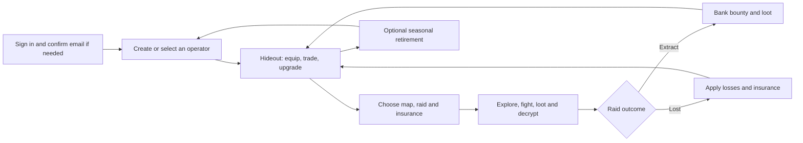

# BoxHead user experience overview

BoxHead's current experience is a desktop browser co-op extraction game: prepare an operator, risk a loadout, extract with loot, then decide what to keep or invest. This overview describes `3.0.0-playtest.1` and the changes accompanying it, as of November 15, 2026. Planned improvements are tracked in [ROADMAP.md](ROADMAP.md); they are not available features.

## The complete player journey

### Arrival and sign in

The home screen offers Play, Learn to Play, About and Controls. The build label, host notice and optional feedback link establish what testers are playing and where to report problems. The field guide is available before sign-in.

There is no guest deployment. Email, Steam and Bluesky sign-in are supported; Google appears when configured by the host. An email-only signup can explore the hideout immediately, but must confirm its email before deploying or hosting. Resend and password reset flows support recovery. Linked identities lead to the same account rather than separate inventories.

The intended first-session outcome is one understood extraction or loss followed by an informed second deployment. A successful sign-in alone does not demonstrate that onboarding works.

### Operator creation and identity

An account can hold three operators. Each owns its own gear, cash, Homefront and map ranks. The selected operator's stored name is the callsign seen in a raid; deployment cannot override it with a client-supplied name. Players should choose a name they are comfortable sharing.

New operators receive a power 6 Service Pistol, power 4 Padded Vest, power 4 Canvas Satchel and $400. The secondary slot is empty, so their initial gear score is 3. Safe operators are the normal playtest choice. Their Homefront can reach tier 3 and they can access all four PvE maps if their gear qualifies.

### Preparing in the hideout

| Surface | What the player does | Decision it supports |
| --- | --- | --- |
| Stash | Filter and sort items, inspect comparisons, equip, sell or bulk-sell, pack sealed loot | Keep an upgrade, bank cash, or risk a sealed item again |
| Trader | Buy replacement equipment and inspect available power levels | Spend now to recover or save for a larger upgrade |
| Homefront | Raise the tier, build facilities, collect Workshop cash, inspect Operations | Invest earnings in lasting operator benefits |
| Base | Build a 17×17 defense map, compose 3 attack waves, run free practice raids, scout and raid rivals (when PvP is on), watch fogged replays | Turn cash into base defense, test layouts safely, and strike rival bases |
| Operators | Create, select, opt Safe→Raidable (when PvP is on) or delete characters; inspect Legacy and retirement | Commit to one character or maintain separate progression paths |

The stash and raid pack are different inventories. The equipped pack is a piece of gear; its contents are carried loot. Insurance returns the equipped pack on a loss, along with the other equipped gear, but never its contents. Valuables also fund Homefront tier upgrades. Protect items to reserve them against sale, automatic pack replacement and tier consumption; unprotect them before spending them. This is distinct from raid insurance. Homefront offers targeted gear requisitions earned through extraction, and Workshop income banks automatically on return. Legacy allocations can be reset for $1,000 with confirmation.

### Choosing a raid

The deploy screen connects the selected operator, map requirement, entry fee, insurance premium and raid choice. Locked maps require gear score, not account age or Operations rank. Filling an empty slot can matter more than replacing an already strong item.

Players start in the shared cross-platform matchmaking pool by default and can switch off cross-platform play to match only within their current sign-in platform pool. Friends who cannot find the same raid should compare their pools first. Hosting and choosing a shared raid are available; a party invitation and ready-check system is future work.

### The raid experience

The player spawns at an edge with a personal 10–13 minute timer. The core decisions are which building to enter, whether to spend ammunition or use melee, whether to decrypt valuable sealed loot, and when to leave. A full pack is a reason to reassess risk, not an instruction to wait until the timer expires.

The HUD supplies health, ammunition, weapon and tactical state, pack capacity, raid time, extraction guidance, combo and camping warnings. **M** opens the map with nests, uplinks and extraction points; **I** opens the pack with item details and drop controls. Both leave the simulation running. **P** pauses only when the player is alone, and a new arrival resumes the raid.

Ordinary monsters have limited sight, pursuit and home territory. Breaking sight or retreating can end an encounter. Decryption makes noise, while lingering draws a finite hunter pursuit. These rules should let players explain why danger appeared and how they escaped it. See [GAMEPLAY.md](GAMEPLAY.md) for exact behavior.

### Outcome and the next attempt

Extraction requires six seconds inside a green ring. The result screen reports the outcome, loot, bounty and progression. Excess extracted loot waits in the stash’s review panel. Keep selected items and explicitly confirm sales before deploying again; protected items require unprotecting before sale. A death, timeout or abandonment loses carried loot and uninsured equipment; stash items left at home remain safe. A settled loss keeps earned activity XP; an empty run earns none. Results show assists, crates and credited revives alongside XP.

A player with no gear can use the weaker loaner pistol and two-slot pouch on free-entry Outskirts. This is the recovery path after losing everything. Server restarts void unfinished raids and return equipment, staged loot, entry fees and insurance premiums. Disconnecting after play has begun is currently abandonment, with no reconnect grace period.

## Social experience and privacy

| Relationship | Shared identity | Behavior when the friend changes operator |
| --- | --- | --- |
| Account friend | Permanent account ID and the current operator while online | Remains connected and shows the new operator |
| Operator friend | Only that operator's independent public ID, name and status | Original operator appears offline; the other character is not revealed |

The Friends screen exposes both shareable IDs and explains the relationship type before adding. Adding creates a mutual link immediately; there is no request acceptance inbox yet. Removing one tier does not remove the other. Deleting or retiring an operator removes its operator friendships; account friendships survive operator retirement.

Presence covers menus, hideout and raids. Closing one browser tab does not hide another connected tab. Heartbeats clean up broken connections, so a network failure can take time to appear offline. Presence is not a squad invitation or a guarantee of matching into the same raid.

## Usability gaps and validation

The desktop keyboard and mouse flow is the supported playtest path. Touch controls cover movement, aiming, melee and weapon switching, but do not yet provide the complete inventory, map and deployable experience. A complete touch or controller release remains future work.

| Question to validate | Observe in a playtest | Planned response if it fails |
| --- | --- | --- |
| Can a newcomer start without coaching? | Signup, confirmation, operator creation and first deploy | Contextual onboarding and clearer recovery actions |
| Do players understand risk before committing? | Ask what insurance saves and what leaving loses | A clearer deployment cost and loss summary |
| Can a player identify the next upgrade? | Inspect empty slots, gate requirements and retained valuables | Explain the gear-score gap and protect wanted items |
| Does combat feel fair? | Ask what caused a chase, hit or hunter warning | Improve threat cues and resolve sight or collision defects |
| Can friends play together? | Two new accounts find a common pool and raid | Party, invite and readiness work after core reliability |
| Can players recover from a loss? | Watch the next loadout and deployment choice | Improve results guidance and recovery recommendations |

Use the [playtest runbook](PLAYTEST.md) for the smoke checklist. Record observed confusion separately from feature requests. Do not present proposed onboarding or retention targets as measured results.

## Implementation references

Menus, identity, raid HUD and results are in [main.ts](../frontend/src/main.ts); stash, facilities and operator management are in [hideout.ts](../frontend/src/hideout.ts). The [field guide](../frontend/src/learn.html), [friend models](../frontend/src/lobby.ts), [presence client](../frontend/src/presence.ts) and [server endpoints](../backend/src/main.rs) define the remaining flows.
